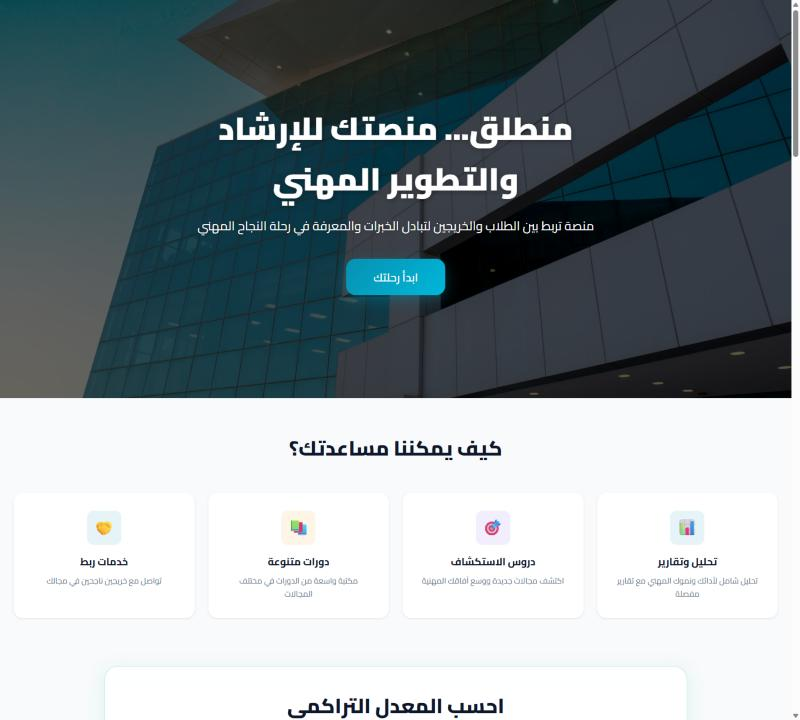
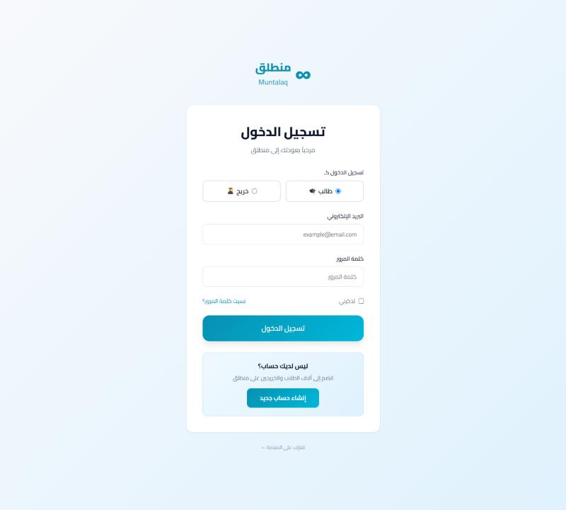
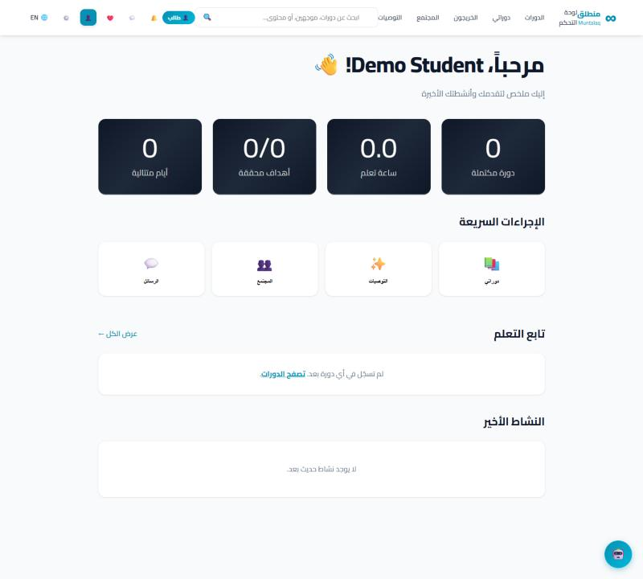
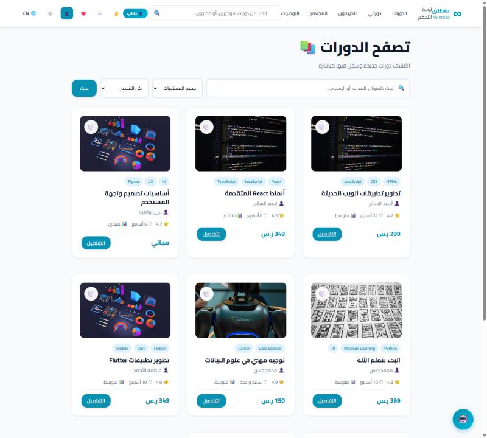
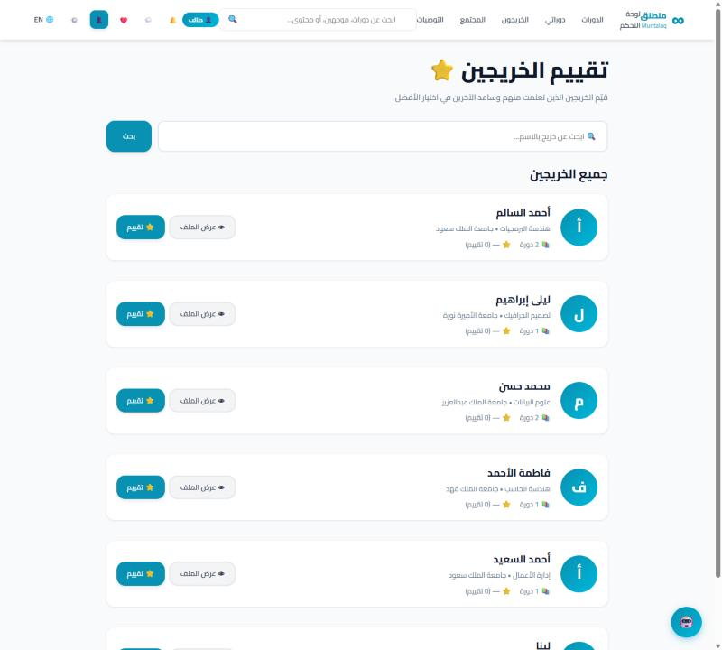
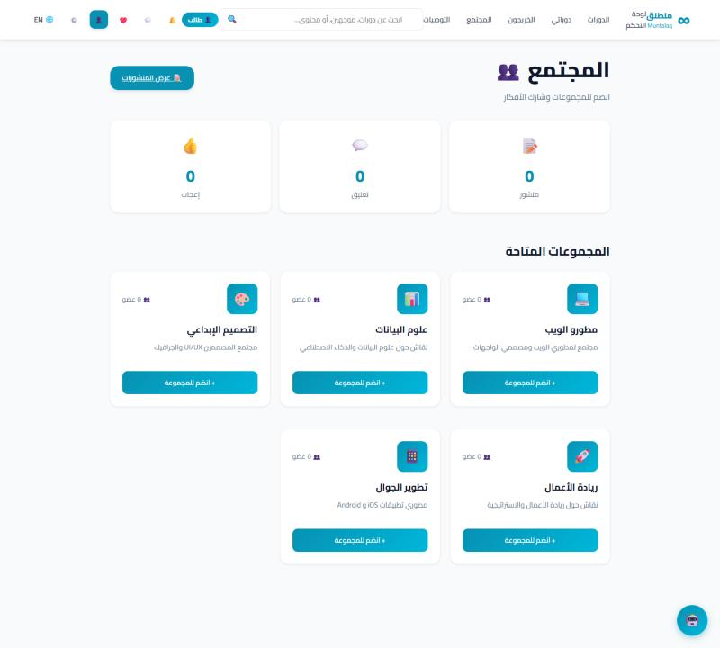
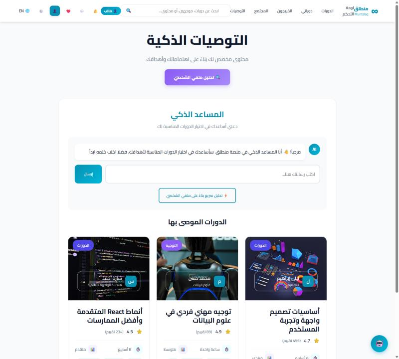
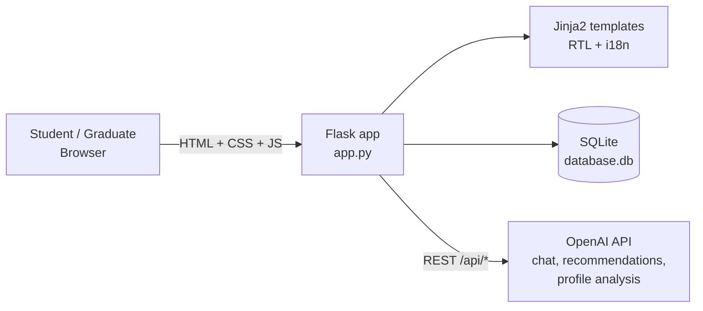

<div align="center">

# Muntalaq · منطلق

**AI-powered academic mentorship and learning platform**
connecting university students, graduates and AI for a better academic journey.




</div>

Muntalaq was developed as a **Senior Project in Software Engineering at the University of Jeddah**.
It gives students one place to find mentors, take courses, get AI guidance and join a community.
The interface is **Arabic (RTL) with an English switch**.

## Table of contents

[The problem](#the-problem) · [Features](#features) · [Screenshots](#screenshots) · [Architecture](#architecture) · [Quick start](#quick-start) · [Configuration](#configuration) · [Demo data](#demo-data) · [Tests](#tests) · [Project structure](#project-structure) · [Demo video](#demo-video)

## The problem

University students struggle to find accessible academic guidance, suitable mentors among graduates,
relevant learning resources and personalised support — usually scattered across many tools.
Muntalaq brings these into **one platform**.

## Features

| Area | What you get |
| --- | --- |
| **Accounts** | Separate **student** and **graduate** sign-up and login, email verification, forgot / reset password |
| **Dashboard** | Learning progress, completed courses, goals, streak, quick actions, recent activity |
| **Courses** | Browse and filter courses (level, price, search), course details, checkout / enroll, lessons, progress tracking, favorites |
| **Course management** | Graduates create courses, add / delete lessons, cancel and republish courses |
| **Graduates** | Directory with search, public graduate profile, ratings and evaluations |
| **AI assistant** | Chatbot, personalised **AI course recommendations**, profile analysis (OpenAI API) |
| **Community** | Interest groups, group chat, posts with likes and comments |
| **Messaging** | Direct messages between students and graduates, share a course in chat, course offers |
| **Notifications** | Unread notifications with mark-all-read |
| **Profile & settings** | Profile photo upload, interests, preference toggles, language switch (AR / EN) |

## Screenshots

> Captured from the running application with the seeded demo data.

<table>
  <tr>
    <td width="50%"><b>Login</b><br></td>
    <td width="50%"><b>Student dashboard</b><br></td>
  </tr>
  <tr>
    <td><b>Course catalogue</b><br></td>
    <td><b>Graduate directory and ratings</b><br></td>
  </tr>
  <tr>
    <td><b>Community groups</b><br></td>
    <td><b>AI assistant and recommendations</b><br></td>
  </tr>
</table>

## Architecture



The app is a single Flask application with server-rendered Jinja2 templates and a set of JSON endpoints
(`/api/...`) used by the front end for chat, notifications, favorites, likes, comments and messaging.
SQLite tables (`users`, `courses`, `enrollments`, `favorites`, `posts`, `groups`, `chat_messages`, ...) are
created and migrated automatically on first run.

## Quick start

```bash
git clone https://github.com/RitalALghates/Muntalaq-Senior-Project.git
cd Muntalaq-Senior-Project

python -m venv .venv
# Windows:  .venv\Scripts\activate      macOS / Linux:  source .venv/bin/activate
pip install -r requirements.txt

cp .env.example .env        # then edit the values (see Configuration)
python app.py
```

Open **http://127.0.0.1:5001**. The database is created and seeded automatically on first launch.

## Configuration

Create a `.env` file (never commit it — it is git-ignored):

| Variable | Purpose |
| --- | --- |
| `FLASK_SECRET_KEY` | Secret used to sign sessions. If missing, a temporary random key is generated (sessions reset on restart). |
| `OPENAI_API_KEY` | Enables the AI assistant, recommendations and profile analysis. The rest of the app works without it. |
| `FLASK_DEBUG` | Set to `1` for Flask debug mode in local development only (default `0`). |

## Demo data

On the first run (when `database.db` does not exist) the app seeds:

- 5 demo graduates (password `Demo@123`, e.g. `ahmad.salem@muntalaq.com`)
- 7 published courses across different fields
- 5 community groups

Create a student account from the sign-up page to explore the student experience.
These accounts are for **local development only**.

## Tests

```bash
pip install pytest
pytest -q
```

The suite covers login / registration, profile, settings, courses, my courses, favorites, graduates evaluation,
community, messages, notifications, the student dashboard and the AI endpoints.
Some tests assume a particular database state, so run them against a fresh `database.db` when possible.

## Project structure

```text
Muntalaq-Senior-Project/
├── app.py               # Flask app: routes, database setup, AI endpoints
├── templates/           # Jinja2 templates (RTL, bilingual)
├── static/              # CSS and images
├── tests/               # pytest suite
├── docs/screenshots/    # README screenshots
├── requirements.txt     # Python dependencies
├── .env.example         # Environment variable template
├── CHANGES.md           # Requirement-by-requirement change log (FR1–FR16, NFR1–NFR7)
└── README.md
```

## Development approach

Developed with an **Agile** process: requirements gathering (surveys with students and graduates),
analysis, system design, implementation, testing and evaluation.
Disciplines involved: software engineering, web development, AI, databases, software testing and REST APIs.

## Demo video

[Watch the Muntalaq demo](https://drive.google.com/file/d/1eQa1G0HIGm6MrwtKyTz0KMtT_DYFjYuZ/view?usp=drive_link)

---

<div align="center"><sub>Muntalaq – Connecting Students, Graduates, and AI for a Better Academic Journey.</sub></div>
